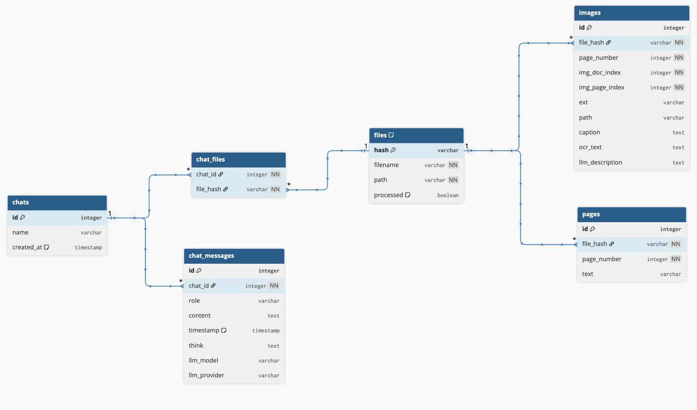
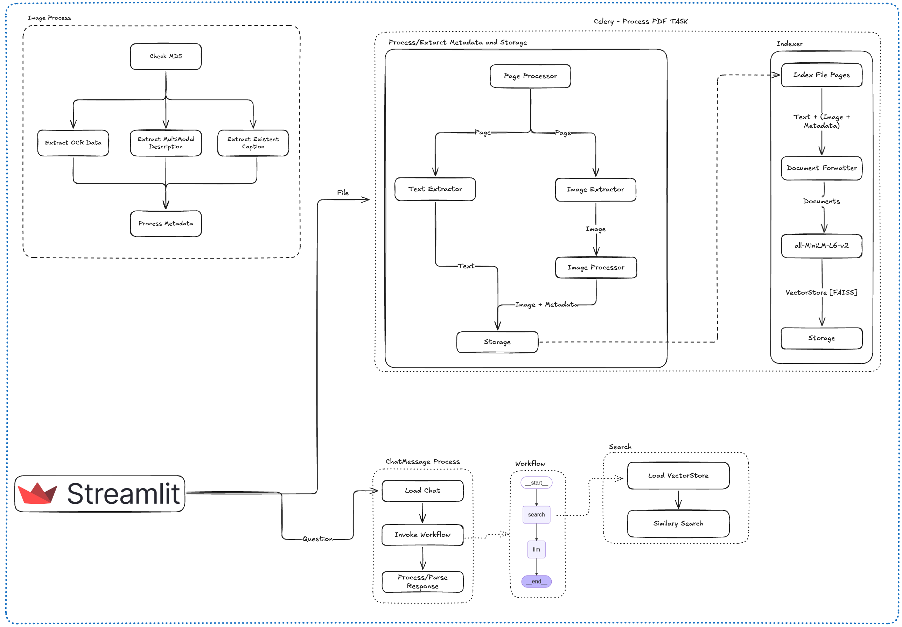

# 📚 Papyrus AI

> A inclusão de conteúdo visual indexado melhora a precisão de respostas em RAG sobre PDFs com elementos multimodais?

**Converse com seus PDFs de forma inteligente!**

> **LLMs e Vetorização Semântica para Interação Multimodal com Documentos PDF: Uma Abordagem de Geração Aumentada por Recuperação (RAG)**

## 🧠 Visão Geral

Papyrus AI é uma plataforma interativa para leitura e análise de documentos PDF usando **LLMs**, **recuperação semântica vetorial** e **multimodalidade** (texto + imagens). A aplicação permite que usuários interajam com seus arquivos por meio de uma interface de chat, fazendo perguntas em linguagem natural e recebendo respostas baseadas em conteúdo textual e visual.

A arquitetura é modular e extensível, combinando:

- Geração Aumentada por Recuperação (RAG)
- Vetorização semântica com FAISS
- Processamento multimodal com LLMs como Gemini e Ollama
- Interface moderna com Streamlit
- Execução assíncrona via Celery

## 🎯 Objetivo

> Desenvolver uma plataforma interativa para exploração de documentos PDF, combinando técnicas modernas de NLP, visão computacional e interação via linguagem natural.

## 🖼️ Interface

### Chat Multidocumento

Permite múltiplos chats com múltiplos arquivos por chat:


## ⚙️ Arquitetura

### Visão Geral


### Componentes

- **Streamlit**: interface principal e chat interativo
- **Celery + Redis**: gerenciamento assíncrono de tarefas
- **PostgreSQL**: armazenamento relacional de chats, arquivos e mensagens
- **FAISS**: armazenamento vetorial de embeddings
- **LLM [Ollama / Gemini]**: provedores de LLMs multimodais

## 🗃️ Estrutura do Banco de Dados



## 🔁 Fluxo de Processamento

### Etapas



1. **Extração de Conteúdo (Texto + Imagens + OCR)**
2. **Processamento de Imagens** (caption, OCR, descrição multimodal)
3. **Indexação Semântica** com embeddings via `all-MiniLM-L6-v2`
4. **RAG + Workflow** com `LangGraph`
5. **Geração de Resposta com Evidência** (imagem + fonte + texto)

## 🚀 Como Rodar

### Pré-requisitos

- Docker e Docker Compose
- `.env` configurado (veja abaixo)
- Pull de modelos necessários (HuggingFace e/ou Ollama se local)

### 🧩 Passos

1. **Configure as variáveis de ambiente:**

```bash
cp .env.example .env
# Preencha com suas chaves (ex: GOOGLE_API_KEY, OLLAMA_BASE_URL)
````

2. **Baixe o modelo de embeddings (necessário para indexação):**

```bash
python ./utils/download_all_miniLM.py
```

3. **Construa os containers:**

```bash
docker-compose build
```

4. **Suba a aplicação:**

```bash
docker-compose up
```

5. **Inicialize ou resete o banco de dados (opcional):**

```bash
docker-compose exec app bash
python ./db/init_db.py
```

6. **(Opcional) Inspecione o banco diretamente:**

```bash
docker-compose exec db psql -U papyrus -d papyrusdb # use suas credenciais
```

### 🧠 Suporte a Múltiplos LLMs

Papyrus é compatível com múltiplos provedores:

* `Gemini` (Google) — via `google-genai`
* `Ollama` — modelos locais como `llava`, `mistral`, `deepseek` etc.

#### ⚠️ Para usar Ollama

1. Tenha o [Ollama](https://ollama.com) instalado localmente ou via docker
2. Execute localmente e de pull nos modelos necessários:

```bash
ollama pull llava:7b
ollama serve
```

3. Defina no `.env` se necessário

```env
OLLAMA_BASE_URL=http://host.docker.internal:11434
```

## 🧩 Tecnologias & Bibliotecas

* `streamlit`, `streamlit_pdf_viewer`
* `langchain`, `langgraph`, `langchain_ollama`, `langchain_google_genai`
* `sentence-transformers`, `faiss-cpu`
* `PyMuPDF`, `pytesseract`, `Pillow`
* `psycopg2`, `sqlalchemy`
* `celery`, `redis`
* `docker`, `dotenv`, `httpx`
