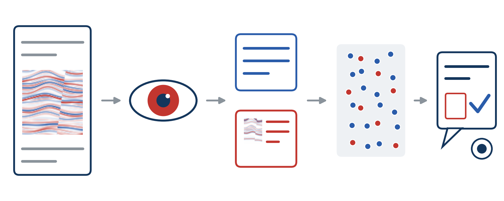
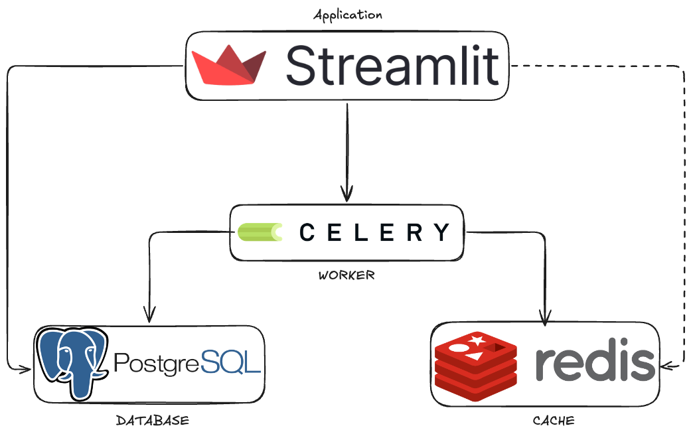
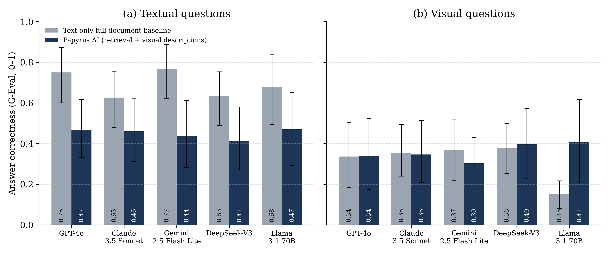
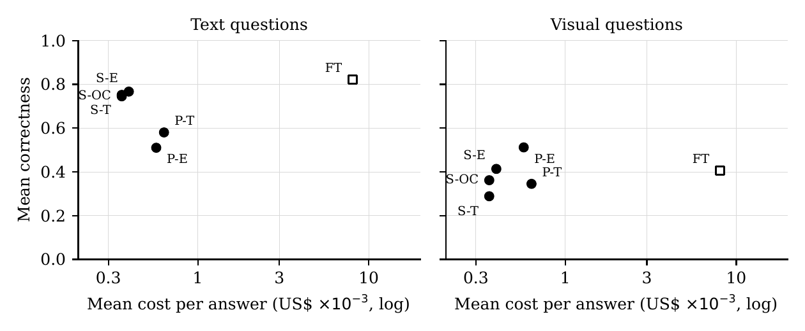
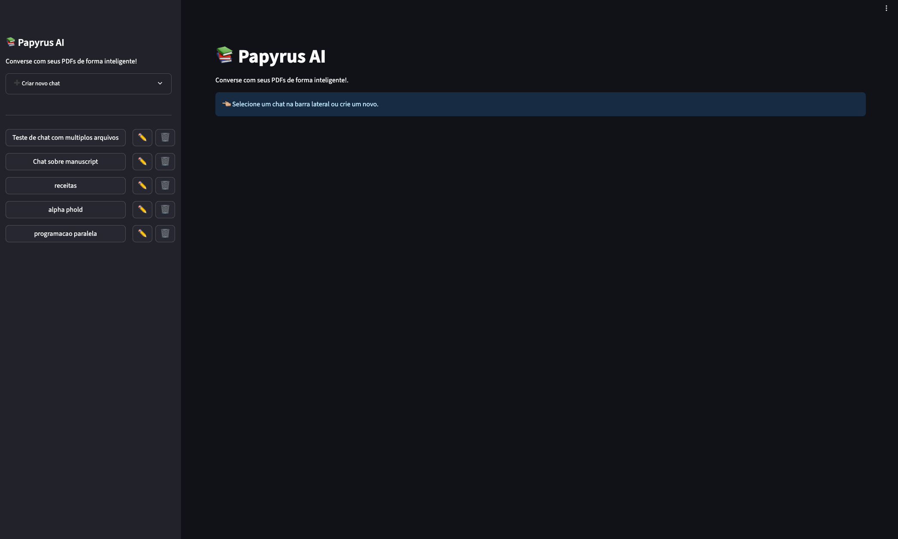

# Papyrus AI

> **Paper submitted to [IEEE Latin America Transactions](https://latamt.ieeer9.org/index.php/transactions/index)**
> *Ingestion-Time Visual Enrichment for Retrieval-Augmented Generation over Scientific PDFs: Cost and Accuracy in a Geophysics Case Study*
> Ernane Ferreira Rocha Junior (UFRN), Victor do Nascimento Gomes (UFRN), José Augusto Agripino de Oliveira (UFRN), Ignacio Sánchez-Gendriz (CETENE), Tiago Tavares Leite Barros (UFRN), Ivanovitch Medeiros Dantas da Silva (UFRN), Luiz Affonso Henderson Guedes de Oliveira (UFRN)

Code and data for the paper above. Papyrus AI is a retrieval-augmented generation (RAG) system for scientific PDFs. Most PDF question-answering pipelines keep only the text layer, so the language model never sees what is inside the figures. Papyrus AI reads each figure once, when the PDF is uploaded, and stores what it finds as a text record in the same vector index as the page text. Any text-only LLM can then answer questions about the figures, and each answer cites the file and page it came from.



## How it works

1. **Extraction.** PyMuPDF splits each page into text and embedded images. Images are deduplicated by MD5.
2. **Image records, once per image.** Tesseract reads the printed text (OCR), a vision-language model (Gemini 2.5 Flash by default) writes a description, and the caption is the "Figure N." block printed next to the image on the page, found from the page layout (an LLM reads the page text only when no such block exists). The three fields form one image record.
3. **Text chunking.** Each page is cut into 800-character windows with 200 characters of overlap, and each window keeps its page number.
4. **Indexing.** Text chunks and image records are embedded with `all-MiniLM-L6-v2` into one FAISS index per document.
5. **Answering.** A LangGraph flow retrieves the top 5 chunks, builds a prompt with grounding rules, and asks the chat model to answer only from that context and to cite `Source: <file>, page <n>`.



| Component | Role |
|---|---|
| Streamlit and LangGraph (`app`) | Chat interface and the retrieval and answer flow |
| Celery (`worker`) and Redis | Ingestion in the background |
| PostgreSQL (`db`) | Chats, files, pages, image records and messages |
| FAISS | One vector index per document |
| LLM providers | Gemini, OpenAI-compatible APIs (OpenRouter, Groq, DeepSeek), Ollama for local models |

## Requirements

- Docker and Docker Compose
- API keys for the chat model and the vision model (or Ollama for local models)
- Python 3.10 to rerun the experiments outside Docker

## Quick start

```bash
cp .env.example .env                   # database, providers, models and keys
python utils/download_all_miniLM.py    # embedding model used by the indexer
docker compose up --build              # app on http://localhost:28502
```

Create a chat in the sidebar, attach one or more PDFs, and wait for the worker to finish ingestion. To reset the database, run `docker compose exec app python db/init_db.py`.

The database and Redis values in `.env.example` already match `docker-compose.yml`. Each LLM role has its own provider, model and key: chat (`LLM_*_CHAT`), image description (`LLM_*_IMAGE_DESCRIBER`) and caption extraction (`LLM_*_CAPTIONS`). Providers are `gemini`, `openai` and `ollama`. For OpenRouter, use `openai` and set `OPENAI_BASE_URL=https://openrouter.ai/api/v1`. For Ollama, set `OLLAMA_BASE_URL=http://host.docker.internal:11434`.

| Variable | Default | Effect |
|---|---|---|
| `TEXT_CHUNKING` | `subpage` | `subpage` (overlapping windows) or `page` (first 1,800 characters of each page, the Study 1 setting) |
| `CHUNK_SIZE`, `CHUNK_OVERLAP` | `800`, `200` | Window size for `subpage` |
| `DISABLE_OCR`, `DISABLE_MULTIMODAL_DESCRIPTION`, `DISABLE_LLM_CAPTION_EXTRACTION` | `false` | Turn off parts of the image record |

## Repository layout

| Path | Contents |
|---|---|
| `app.py`, `frontend/` | Streamlit interface |
| `indexing/` | PDF processing, image records, FAISS index and retriever |
| `llm/` | Caption extractor, image describer and answer prompt |
| `services/` | LangGraph chat flow |
| `tasks/` | Celery ingestion queue |
| `db/` | SQLAlchemy models and queries |
| `experiments/questions.csv` | The 20 benchmark questions with reference answers |
| `experiments/study1/` | Study 1: full-text prompting vs. Papyrus AI, five LLMs, 600 answers |
| `experiments/study2/` | Study 2: six conditions under one prompt and temperature, three LLMs, 720 answers |

## Benchmark

The test document is S. Chopra and K. J. Marfurt, "Seismic attributes: A historical perspective," *Geophysics*, 70(5), 2005, [doi:10.1190/1.2098670](https://doi.org/10.1190/1.2098670). It has 26 pages and 33 embedded images. The benchmark has 20 questions: 10 answered in the prose and 10 about figures. The answers to three of the figure questions (17, 18 and 20) are also stated in the prose; `experiments/study2/visual_split.py` reports them apart from the seven that need the figure. The PDF is copyrighted and is not in this repository. To rerun the experiments, get it through the DOI and save it as `experiments/gsgpy_70_5_3SO.pdf`.

## How the metrics are computed

- Correctness: DeepEval 3.8.4 G-Eval with GPT-4.1 (through OpenRouter) as the judge. The judge compares each answer with the reference answer, without the question, and returns a score from 0 to 1. The criteria text says "Rate it from 1 to 5" while the DeepEval template asks for 0 to 10; scores of 1.0 occur, so the judge used the full range, but the mixed instruction is a known flaw shared by all conditions.
- Faithfulness: DeepEval faithfulness on Papyrus AI answers, that is, the share of claims in an answer that the retrieved context supports.
- Citations: a regular expression checks whether the answer has a source line.
- Cost, tokens and latency: read from the OpenRouter activity exports (`billing_*.csv`), not estimated.
- Statistics: the question is the unit of analysis. Repeated answers are averaged per question, which gives N=10 pairs per category. Conditions are compared with the two-sided Wilcoxon signed-rank test with Bonferroni correction (k=10 in Study 1, k=7 in Study 2). Effect size is r = |Z|/√N, and Study 2 adds 95% bootstrap intervals over questions. A test on the individual answers (N=30) is reported as support only, because those answers are not independent.

## Reproducing the results

Put the keys in `.env` (see `.env.example`). DeepEval reads `OPENAI_API_KEY`, so set it to the OpenRouter key before running the judge.

### Study 1

```bash
pip install -r requirements.txt deepeval==3.8.4 scipy
python experiments/study1/baseline.py    # full-text prompting: 5 models x 20 questions x 3 runs
LLM_MODEL_CHAT=openai/gpt-4o docker compose exec app python experiments/study1/papyrus.py   # one run per model
python experiments/study1/evaluate.py    # correctness and faithfulness, writes scores.csv
python experiments/study1/analyze.py     # statistics, citations and cost, writes results.md
```

`analyze.py` makes no API calls and needs only the CSV files in `study1/`, so it reproduces every Study 1 number in the paper without the PDF or any key. Its output is in [`experiments/study1/results.md`](experiments/study1/results.md).

### Study 2

```bash
cd experiments/study2
python rebuild_records.py     # page text and image records from the PDF and the ingestion log (no API calls)
python validate_replica.py    # checks the offline retriever against the logged retrieval
python evidence_map.py        # locates the evidence for each question in the PDF
python retrieval_study.py     # evidence recall at k=5 for each chunking (no API calls)
python generate.py            # answers for all conditions
python judge.py               # G-Eval correctness
python judge_check.py         # rescores a sample of Study 1 answers to check judge drift
python analyze.py             # tables/, figs/ and analysis.json
```

The answers, scores, tables and figures are in the repository. Rerunning `analyze.py` needs `records.json`, which `rebuild_records.py` builds from the PDF.

## Results

### Study 1: full-text prompting vs. Papyrus AI

Five models, 20 questions, three runs each. The original Papyrus AI configuration used page chunks. Mean G-Eval correctness:

| Model | Text, full text | Text, Papyrus | Visual, full text | Visual, Papyrus |
|---|:---:|:---:|:---:|:---:|
| GPT-4o | 0.75 | 0.47 | 0.34 | 0.34 |
| Claude 3.5 Sonnet | 0.63 | 0.46 | 0.35 | 0.35 |
| Gemini 2.5 Flash Lite | 0.77 | 0.44 | 0.37 | 0.30 |
| DeepSeek-V3 | 0.63 | 0.41 | 0.38 | 0.40 |
| Llama 3.1 70B | 0.68 | 0.47 | 0.15 | 0.41 |
| All models | 0.69 | 0.45 | 0.32 | 0.36 |

- Prompt tokens per query fell from 31,250 to 2,053 (93.4% less), and total cost fell from US$16.58 to US$1.52 (90.8% less).
- Papyrus AI answers had a judge-rated mean faithfulness of 0.943, and 84.3% of them scored 1.0. The DeepEval metric counts a claim as faithful unless the context contradicts it, so read this as an upper bound on grounding.
- 95.0% of Papyrus AI answers named a source ("Source:" or a file name), against 0.7% of full-text answers, whose prompt did not ask for one. Counting page mentions too, the baseline reaches 5.3%.
- Billed costs include provider prompt caching, which favored the full-text baseline (98% of GPT-4o and 97% of Gemini baseline calls were partly cached). At list price the totals are about $18.90 against $1.60, a 91.6% reduction.
- Mean generation time went from 4.57 s to 3.18 s.
- No difference passed Bonferroni correction. The largest effects were the text loss for Gemini 2.5 Flash Lite (r=0.74) and the visual gain for Llama 3.1 70B (+0.26, r=0.65).

### Study 2: what caused the text loss, and what the image records add

Six conditions, three models (DeepSeek-V3, Gemini 2.5 Flash Lite, Llama 3.1 70B), 20 questions, two repetitions. All conditions use the same prompt and temperature 0.3.

| Condition | Text | Visual | Overall | Prompt tokens | Cost per answer (US$) |
|---|:---:|:---:|:---:|:---:|:---:|
| Full text | 0.82 | 0.41 | 0.61 | 31,080 | 0.00804 |
| Page chunks, no images | 0.58 | 0.35 | 0.46 | 2,261 | 0.00063 |
| Page chunks, full image records | 0.51 | 0.51 | 0.51 | 2,001 | 0.00057 |
| Sub-page chunks, no images | 0.75 | 0.29 | 0.52 | 1,192 | 0.00036 |
| Sub-page chunks, OCR and caption | 0.75 | 0.36 | 0.55 | 1,174 | 0.00036 |
| Sub-page chunks, full image records | 0.77 | 0.41 | 0.59 | 1,222 | 0.00040 |

Planned comparisons (question means, N=10 before zero differences are dropped, Bonferroni k=7; `tables/paired_tests.csv` gives the effective N of each test):

| Comparison | Category | Difference [95% CI] | p | p corrected | r |
|---|---|:---:|:---:|:---:|:---:|
| Image records, page chunks | visual | +0.17 [0.04, 0.31] | 0.086 | 0.60 | 0.54 |
| Image records, sub-page chunks | visual | +0.13 [0.00, 0.27] | 0.208 | 1.00 | 0.40 |
| VLM description over OCR and caption | visual | +0.05 [−0.04, 0.20] | 0.813 | 1.00 | 0.08 |
| Sub-page vs. page chunks | text | +0.26 [0.10, 0.43] | 0.017 | 0.12 | 0.75 |
| Study 1 configuration vs. full text | text | −0.31 [−0.50, −0.13] | 0.041 | 0.29 | 0.65 |
| Revised configuration vs. full text | text | −0.06 [−0.20, 0.09] | 0.407 | 1.00 | 0.26 |
| Revised configuration vs. full text | visual | +0.01 [−0.13, 0.16] | 0.799 | 1.00 | 0.08 |

Page chunks indexed only 37% of the document text. Sub-page chunks, which index all of it in smaller pieces, removed most of the Study 1 text loss; the change alters coverage and chunk size together, so it does not isolate either. With sub-page chunks and full image records, the comparison with full-text prompting on visual questions was inconclusive (+0.01, 95% CI -0.13 to +0.16, with opposite signs across models) at about 5% of the cost. Image records raised visual correctness over text-only retrieval, but the split between OCR text with captions and the VLM description is bounded by truncation, and the +0.05 for the description comes almost entirely from question 13, where the description made the target image record retrievable: `rag.py` keeps the first 600 characters of OCR text and 400 of the description, and the answers to questions 18 to 20 lie beyond both cuts in the Figure 1 record. No difference survives Bonferroni correction. On the seven visual questions that need the figure, image records added 0.18 with page chunks and 0.10 with sub-page chunks, and the description added 0.10 over OCR text and captions (`tables/visual_split.csv`).

The captions in these results come from an earlier extractor that asked an LLM for the caption of image N, where N counted every image in the document. The journal logo is image 1, so the count ran one ahead of the figure numbers, and only 6 of the 32 figures got their own caption (`experiments/study1/caption_check.py`). The current extractor matches captions by page layout and assigns all 32 correctly. A rerun of the three caption-dependent conditions with these captions (`experiments/study2/analyze_layout.py`, 360 answers, same models, prompt and judge) changed visual correctness by -0.03 to +0.01, within the run-to-run variation measured on questions whose prompt did not change. For most questions about Figures 10 to 12 the retriever does not return that figure's image record with either caption version, so retrieval, not caption accuracy, limits those questions. In the rerun, OCR text and captions added 0.05 and the VLM description 0.09 on visual questions. The tables above report the original run.

The main judge does not see the question, and its criterion text (1 to 5) conflicts with the 0 to 10 scale of the DeepEval template. `judge.py --with-question` scores the answers again with the same judge model, the question in the input, five hand-written steps (`geval_steps_q.json`) and the 0 to 10 scale only, into `scores_q.csv` and `scores_layout_q.csv`. `analyze_rescore.py` compares the two configurations (`tables/rescore.json`). Over all 1,080 Study 2 answers the two agree in rank (Spearman 0.88); the second is more generous (mean 0.60 against 0.54). Under it, the chunking effect stays at +0.26 [0.09, 0.45] and the sub-page image gain is +0.18 [0.03, 0.34], but the page-chunk image gain falls to +0.05 [-0.03, 0.15], and the revised configuration loses 0.10 [-0.21, -0.01] against the full text on textual questions and 0.07 [-0.20, 0.07] on visual ones. No comparison passes Bonferroni correction under either configuration.

## Figures

| | |
|---|---|
|  |  |
| Study 1: correctness per model and question type | Study 2: cost per answer and correctness for each condition |



## Citation

This repository accompanies a paper under review at IEEE Latin America Transactions. If you use this code, please cite:

```bibtex
@article{rocha2026ingestion,
  author  = {Rocha Junior, Ernane Ferreira and Gomes, Victor do Nascimento and Oliveira, Jos{\'e} Augusto Agripino de and S{\'a}nchez-Gendriz, Ignacio and Barros, Tiago Tavares Leite and Silva, Ivanovitch Medeiros Dantas da and Oliveira, Luiz Affonso Henderson Guedes de},
  title   = {Ingestion-Time Visual Enrichment for Retrieval-Augmented Generation over Scientific {PDFs}: Cost and Accuracy in a Geophysics Case Study},
  journal = {IEEE Latin America Transactions},
  note    = {Under review},
  year    = {2026}
}
```

Related work by the first author: the M.Sc. dissertation "Ingestion-Time Visual Enrichment for Retrieval-Augmented Generation over Scientific Documents" (PPgEEC/UFRN, 2026) and the undergraduate thesis "LLMs e Vetorização Semântica para Interação Multimodal com Documentos PDF" (UFRN, 2025, [repository](https://repositorio.ufrn.br/items/0d91f59a-21de-4477-b27f-236c469d7661)).

## Notes

- With 10 questions per category the results are exploratory. No comparison in either study passes Bonferroni correction on question means.
- The judge is an LLM. Rescoring 40 Study 1 answers with the fixed Study 2 rubric gave a Spearman correlation of 0.94 with the original scores and a mean shift of +0.08.
- A few strings in `llm/generator.py`, `indexing/indexer.py` and `indexing/processor.py` are in Portuguese. They are the prompt and log format used in the experiments, and the Study 2 scripts parse them, so they were kept as they are.

## Acknowledgments

Supported by Petrobras through the "Cognitive Assistant for Geophysical Data" project, with support from ANP through the R&D levy regulation, by CAPES, and by FUNPEC.

## License

The code is released under the [MIT License](LICENSE). The `retrieval_context` columns and the model answers in `experiments/` contain short passages from the test document (Chopra and Marfurt, 2005, doi:10.1190/1.2098670). They are kept so that the scores can be checked, and they remain under the publisher's copyright; the MIT License does not cover them. The paper itself is not distributed here.
